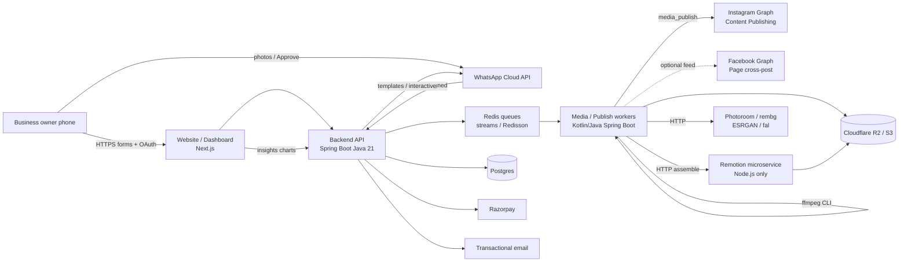

# Instagram Marketing Automation Platform — Technical Design

**For:** Ashish (Punjab SWE) — solo, part-time alongside a full-time job  
**Capacity assumption:** **~8–15 focused hours/week** (evenings + weekends). Planning midpoint **~12 hrs/week** ≈ **0.3 FTE**. One full-time person-week (~40 hrs) ≈ **3–5 calendar weeks** of evening work.  
**Product:** WhatsApp-in → AI polish → HITL approve → Instagram (optional Facebook) out for Indian local businesses (salon, clinic, furniture, tuition).  
**Constraint:** **Official Meta APIs only** — WhatsApp Cloud API + Instagram Graph Content Publishing + Facebook Graph. **No** Baileys, whatsapp-web.js, IG private APIs, scrapers, or password collection.  
**Companions:** [`instagram-business-onboarding-flow.md`](./instagram-business-onboarding-flow.md) · [`ai-media-generation-pipeline.md`](./ai-media-generation-pipeline.md) · [`instagram-platform-monthly-costs.md`](./instagram-platform-monthly-costs.md) · [`whatsapp-groups-api-capabilities.md`](./whatsapp-groups-api-capabilities.md) · [`meta-page-creation-api-capabilities.md`](./meta-page-creation-api-capabilities.md) · [`instagram-platform-build-timeline.md`](./instagram-platform-build-timeline.md) · [`rozpost-production-best-practices.md`](./rozpost-production-best-practices.md)  
**Research / design date:** 2 Nov 2026. (Production architecture + best-practice decisions added same day.)

---

## 0) Executive summary

| Question | Answer |
| --- | --- |
| Architecture shape | Multi-tenant SaaS: Next.js site + Spring Boot (Java 21) API + Kotlin/Java media/publish workers + small Node Remotion service + Postgres + R2 + Redis; Meta WA/IG/FB as external systems |
| Intake | **WhatsApp Cloud API 1:1** (not Groups for MVP — OBA gate) |
| Creative default | Photoroom/rembg + Real-ESRGAN + ffmpeg 9:16 + Remotion captions (Noto Devanagari/Gurmukhi); I2V optional v2 |
| HITL | Approve / Disapprove (+ voice/text note) on WhatsApp; max **3** regen retries |
| Auth to Meta | Client converts to Professional **in IG app**; then Instagram Login and/or Facebook Login for Business |
| MVP calendar (part-time) | **~12–18 weeks coding** wall-clock; Meta App Review / WABA often **+4–12 weeks** overlapping or serial |
| Production-ish **v1** | **~6–10 calendar months** from zero (coding + Meta gates + buffer) |
| Paid-pilot cut (60–90 days) | Strip analytics/A-B/I2V/Promote/scheduling/polish; ship onboarding + 1:1 WA + stills + simple reel + approve + publish on test/owned assets while App Review runs |

---

## 1) High-level design (HLD)

### 1.1 System context



### 1.2 Logical components

| Component | Responsibility |
| --- | --- |
| **Website frontend** | Marketing landing, onboarding wizard (phone + business fields + optional photo), IG/FB Connect buttons, analytics dashboard (session login), billing UX |
| **Backend API** | Spring Boot (Java 21): auth (owner sessions + long-lived WA analytics link tokens), tenant CRUD, OAuth callbacks, webhook ingress, enqueue jobs, Razorpay webhooks, admin ops |
| **WhatsApp Cloud API webhook** | Verify `X-Hub-Signature-256`, idempotent ingest of messages/media/statuses, route by WA user id → `tenant_id` / `client_id`, drive approval FSM replies |
| **AI media workers** | Separate Kotlin/Java Spring Boot services: download WA media ASAP → R2; apply optional WA `instruction_text` when enhancing stills (Photoroom/fal HTTP) and rendering reels (ffmpeg CLI + Node Remotion); write previews; notify WA for HITL |
| **Remotion microservice** | Small **Node.js-only** service for caption/reel assembly (Remotion requires JS); invoked over HTTP by Java/Kotlin workers |
| **IG / FB Graph adapters** | Create media container → poll → `media_publish`; read `content_publishing_limit`; optional Page feed cross-post; insights pull |
| **Analytics pipeline** | Periodic Insights sync + website visit events → Postgres rollups → dashboard + WA link |
| **Payment module** | Free tier counter (10–15 clients) → Razorpay subscription/order for **₹299–399/mo** (later ₹1000 SKU) |
| **Scheduler / reminders** | Soft “send more photos” every N days (default 2); best-time publish windows (v1); A/B (v2) |

### 1.3 MVP topology (pragmatic solo deploy)

```
┌─────────────────────────────────────────────────────────┐
│  Vercel: Next.js (marketing + dashboard + thin BFF)     │
└───────────────────────────┬─────────────────────────────┘
                            │
┌───────────────────────────▼─────────────────────────────┐
│  Railway / Fly / Render                                  │
│   • API: Spring Boot (Java 21)                           │
│   • Workers: Kotlin/Java Spring Boot (Redis consumers)   │
│   • Remotion: small Node.js microservice (JS-only)       │
│   • ffmpeg available on worker image (CLI from Java)     │
└───────┬─────────────┬───────────────┬───────────────────┘
        │             │               │
   Neon Postgres   Redis (queues)  Cloudflare R2
```

Scale-up later: split CPU-heavy / Remotion instances; Temporal for long HITL timers; per-region egress if Meta fetch latency hurts.

### 1.4 Data flow — happy path (MVP)

```
1. Owner completes website onboarding → tenant + client row
2. Owner converts IG → Professional in-app (guided QR / Help Center)
3. OAuth Connect → encrypted long-lived tokens stored per tenant
4. Owner sends photo/video on WhatsApp 1:1 (optional caption/instruction text — style notes, “design like this”, background story)
5. Webhook → persist message + instruction_text → download media → R2 → enqueue MediaJob (payload includes instruction_text)
6. Worker: enhance / reel render **using instructions when present** → preview URLs → WA interactive Approve|Disapprove
7. Approve → PublishJob → quota check → IG container → publish → permalink reply
8. Disapprove + note → retry (≤3) with feedback in prompt/template params
```

### 1.5 Explicit non-goals (MVP)

- WhatsApp **Groups** intake (needs OBA; see Groups companion) — design 1:1 only until eligibility is real.
- Auto-**create** Instagram Business accounts or Pages as a factory (not supported; see Page/onboarding companions).
- Launching ads **from** WhatsApp — v2 only prepares creative + sends a **Promote / Ads Manager** deep link.
- Cursor agents as the production queue (build-time only).

---

## 2) Low-level design (LLD)

### 2.1 Multi-tenancy model

- Every business row is a **`tenants`** record (`tenant_id`).
- MVP may be **single-agency operator** (Ashish) with many client tenants; later white-label polish is v2.
- Isolation: `tenant_id` on every table; API middleware sets tenant from session / WA routing map; prefer Postgres **RLS** once past prototype.
- Tokens, brand kits, media prefixes (`r2://bucket/{tenant_id}/…`) never cross tenants.

### 2.2 Database schema (Postgres)

Core tables (simplified; add indexes on FKs + status + created_at):

```sql
-- Identity & tenancy
tenants (
  id uuid pk,
  name text,
  slug text unique,
  status text,              -- trial | active | past_due | suspended
  plan text,                -- free | standard | premium
  free_posts_remaining int, -- or free_clients counter at operator level
  locale text,              -- hi-IN | pa-IN | en-IN
  created_at timestamptz
)

users (
  id uuid pk,
  tenant_id uuid fk,
  role text,                -- owner | staff
  phone_e164 text,
  email text,
  password_hash text null,  -- optional; WA-link auth for analytics
  created_at timestamptz
)

clients (
  id uuid pk,
  tenant_id uuid fk,        -- often 1:1 with tenant for SMB self-serve
  business_name text,
  category text,
  city text,
  phone_e164 text,
  wa_user_id text,          -- WhatsApp sender id for routing
  onboarding_status text,   -- see FSM
  photo_asset_id uuid null,
  created_at timestamptz
)

brand_kits (
  id uuid pk,
  tenant_id uuid fk unique,
  logo_asset_id uuid null,
  primary_color text,
  secondary_color text,
  font_stack text,          -- Noto Sans Devanagari / Gurmukhi
  caption_tone text,
  banned_phrases text[],
  default_cta text,
  music_bed_asset_id uuid null
)

-- Meta connections
meta_connections (
  id uuid pk,
  tenant_id uuid fk,
  provider text,            -- instagram_login | facebook_login
  ig_user_id text,
  page_id text null,
  scopes text[],
  access_token_enc bytea,   -- AES-GCM envelope
  token_expires_at timestamptz,
  refresh_meta jsonb,
  status text,              -- active | needs_reauth | revoked
  unique (tenant_id, provider)
)

-- Media & posts
media_assets (
  id uuid pk,
  tenant_id uuid fk,
  source text,              -- whatsapp | upload | generated
  kind text,                -- image | video | audio | thumb
  r2_key text,
  sha256 text,
  width int, height int, duration_ms int,
  wa_media_id text null,
  instruction_text text null, -- optional WA caption / style notes alongside media
  created_at timestamptz
)

jobs (
  id uuid pk,
  tenant_id uuid fk,
  type text,                -- media_download | image_enhance | reel_render | ig_publish | insights_sync
  status text,              -- queued | running | succeeded | failed | dead
  idempotency_key text unique,
  payload jsonb,            -- includes asset ids + instruction_text when provided
  result jsonb,
  attempts int,
  last_error text,
  created_at timestamptz,
  updated_at timestamptz
)

posts (
  id uuid pk,
  tenant_id uuid fk,
  client_id uuid fk,
  type text,                -- image | carousel | reel
  status text,              -- see approval FSM
  source_asset_ids uuid[],
  output_asset_ids uuid[],
  caption text,             -- IG publish caption (may be derived from instructions)
  instruction_text text null, -- owner creative brief from WA (intake); distinct from HITL feedback
  locale text,
  template_id text,
  feedback_text text,
  feedback_audio_asset_id uuid null,
  retry_count int default 0,
  max_retries int default 3,
  scheduled_for timestamptz null,
  published_at timestamptz null,
  ig_container_id text null,
  ig_media_id text null,
  ig_permalink text null,
  fb_post_id text null,
  ab_group text null,       -- v2
  created_at timestamptz
)

approvals (
  id uuid pk,
  post_id uuid fk,
  tenant_id uuid fk,
  channel text,             -- whatsapp
  wa_message_id text,
  decision text,            -- approved | disapproved | expired
  note text,
  decided_at timestamptz
)

-- Analytics & ops
analytics_events (
  id uuid pk,
  tenant_id uuid fk,
  source text,              -- website | ig_insights | system
  metric text,              -- visit | followers | reach | engagement | saves | shares | profile_visits
  value numeric,
  dims jsonb,
  occurred_at timestamptz,
  ingested_at timestamptz
)

analytics_rollups (
  tenant_id uuid,
  day date,
  metric text,
  value numeric,
  primary key (tenant_id, day, metric)
)

reminders (
  id uuid pk,
  tenant_id uuid fk,
  type text,                -- no_input_nudge
  every_days int default 2,
  enabled bool,
  last_sent_at timestamptz,
  next_run_at timestamptz
)

dashboard_tokens (
  id uuid pk,
  tenant_id uuid fk,
  token_hash text unique,   -- long-lived WA deep link
  expires_at timestamptz null,
  revoked_at timestamptz null
)

payments (
  id uuid pk,
  tenant_id uuid fk,
  provider text,            -- razorpay
  external_id text,
  amount_paise int,
  currency text default 'INR',
  status text,
  period_start date,
  period_end date,
  raw jsonb
)

cost_ledger (
  id uuid pk,
  tenant_id uuid fk,
  job_id uuid null,
  category text,            -- wa_msg | image_api | reel_render | storage
  amount_inr numeric,
  meta jsonb,
  created_at timestamptz
)
```

### 2.3 API endpoints (REST sketch)

All product JSON APIs are versioned under **`/api/v1`** from day one. Meta/Razorpay webhook paths stay unversioned (provider-owned URLs).

**Public / owner website**

| Method | Path | Purpose |
| --- | --- | --- |
| `POST` | `/api/v1/onboarding` | Create tenant/client from phone + business fields + optional photo |
| `GET` | `/api/v1/onboarding/:id/status` | Poll onboarding FSM |
| `GET` | `/api/v1/oauth/instagram/start` | Start IG Business Login |
| `GET` | `/api/v1/oauth/instagram/callback` | Store tokens |
| `GET` | `/api/v1/oauth/facebook/start` | FB Login for Business (`config_id`) |
| `GET` | `/api/v1/oauth/facebook/callback` | Store Page + IG tokens |
| `POST` | `/api/v1/auth/login` | Email/password or magic link for dashboard |
| `GET` | `/api/v1/dashboard/summary` | KPI cards (auth session) |
| `GET` | `/api/v1/dashboard/wa/:token` | Long-lived WA analytics link (hashed token) |
| `POST` | `/api/v1/billing/checkout` | Razorpay order / subscription |
| `POST` | `/api/v1/billing/webhook` | Razorpay signed webhook |
| `GET` | `/api/v1/health` | Liveness/readiness for Railway/Fly zero-downtime |

**Internal / worker-facing**

| Method | Path | Purpose |
| --- | --- | --- |
| `GET` | `/api/v1/internal/posts/:id` | Worker fetch |
| `POST` | `/api/v1/internal/posts/:id/assets` | Attach outputs |
| `POST` | `/api/v1/admin/tenants/:id/reauth` | Force re-OAuth |

**Meta webhooks**

| Method | Path | Purpose |
| --- | --- | --- |
| `GET` | `/webhooks/whatsapp` | Hub challenge verify |
| `POST` | `/webhooks/whatsapp` | Messages, statuses, button replies |
| `GET/POST` | `/webhooks/meta` | Optional IG/Page deauthorize / data deletion callbacks |

### 2.4 WhatsApp webhook handlers

1. **Verify signature** — HMAC-SHA256 of raw body with app secret; reject on mismatch.  
2. **Idempotency** — upsert on `wamid`; Meta retries.  
3. **Route** — map `from` (WA id) → `clients.wa_user_id` → `tenant_id`. Unknown senders → soft onboarding template or ignore.  
4. **Media message** — capture optional caption/`instruction_text` on the same message (or a short follow-up text before processing starts); persist on `media_assets` / job `payload`; enqueue `media_download` immediately (WA URLs expire fast).  
5. **Interactive reply** — `Approve` / `Disapprove` button payload → approval FSM.  
6. **Text / voice note** after Disapprove — attach as `feedback_*` (HITL regen notes, not intake instructions), enqueue regen if `retry_count < max_retries`.  
7. **Status webhooks** — delivery/read for reminder suppression and cost accounting.  
8. **Templates** — outside 24h window use pre-approved **utility** for nudges; keep promo wording out of utility (see costs companion).

**MVP intake = 1:1 only.** Do not block MVP on Groups API / OBA.

### 2.5 Job queues (Redis — Java/Kotlin workers)

**Not BullMQ / TypeScript workers.** Prefer Redis Streams, Spring Integration Redis, Redisson delayed/blocking queues, or a thin custom consumer loop in Spring Boot; use **ShedLock** (or Redis-based locks) for cron-style `insights-sync` / `reminders` / `scheduler` so only one instance runs.

| Queue | Concurrency notes | Jobs |
| --- | --- | --- |
| `media-download` | High I/O | Fetch WA media → R2; create `media_assets` |
| `image-enhance` | API-bound | rembg/Photoroom + Real-ESRGAN via HTTP + brand overlay; honor `instruction_text` when set |
| `reel-render` | CPU-heavy; separate service | ffmpeg CLI 9:16 → **Node Remotion**; apply `instruction_text` to layout/caption choices |
| `i2v` | v2; costly | Seedance/Kling HTTP on product/room stills only |
| `ig-publish` | Strict rate | Quota governor → container → poll → publish |
| `fb-crosspost` | v1 | Page photo/video post when connected |
| `insights-sync` | ShedLock cron | Pull IG insights → `analytics_events` |
| `reminders` | ShedLock cron | Soft no-input nudges |
| `scheduler` | ShedLock cron | Fire due `posts.scheduled_for` |

**Patterns:** idempotency keys (`wamid`, `post_id:step`); step checkpoints (skip re-download if `r2_key` exists); exponential backoff on 429/5xx; **no** blind auto-retry on model safety rejects; DLQ + WA “failed, please resend.”

### 2.6 State machines

#### Onboarding

```
started
  → profile_collected          # phone, business fields, optional photo
  → ig_professional_pending    # user in-app conversion (external)
  → oauth_pending
  → oauth_connected
  → wa_linked                  # first inbound WA from registered phone
  → publish_probe_ok           # optional test publish
  → active
  → blocked_needs_reauth
```

#### Approval / publish loop

```
intake_received
  → media_processing
  → drafted
  → awaiting_approval
       ├─ approved → publish_queued → publishing → published
       │                              └─ publish_failed → (manual / retry)
       └─ disapproved
            ├─ retry_count < 3 → media_processing (with feedback)
            └─ retry_count ≥ 3 → abandoned_needs_new_media
```

### 2.7 Quota governor (Instagram)

Before every `media_publish`:

1. `GET /{ig-user-id}/content_publishing_limit`  
2. If near `quota_total` (commonly ~**25**/rolling 24h — **trust live response**), set `scheduled_for` to next window and notify owner.  
3. Product SLA suggestion: **≤1 feed + 1 reel/day** leaves headroom for carousels/retries.

### 2.8 Analytics dashboard access

- **Website login** — session cookie (owner user).  
- **WhatsApp long-lived link** — `https://app…/d/{token}` where token is high-entropy; store **hash only**; show visits, followers, engagement, reach, saves, shares, profile visits from rollups.  
- Metrics sources: IG Insights (Graph) + first-party website visit beacons.

---

## 3) Services list

| Service | Role in product | MVP? |
| --- | --- | --- |
| **WhatsApp Cloud API** | 1:1 intake, interactive Approve/Disapprove, templates, media download | **Yes** |
| **Instagram Content Publishing** | Organic feed/reel publish | **Yes** |
| **Instagram / FB Login** | OAuth connect Professional accounts | **Yes** |
| **Facebook Graph** | Optional Page cross-post; some insights paths | v1 |
| **Photoroom or fal rembg** | Background remove | **Yes** |
| **Real-ESRGAN** (fal/self) | Faithful upscale | **Yes** |
| **ffmpeg** | Cut / reframe 9:16 | **Yes** |
| **Remotion** (Node.js microservice) | Captions, lower-thirds, Ken Burns (Devanagari/Gurmukhi via Noto) — **only** JS island | **Yes** (simple templates) |
| **Seedance / Kling** | Optional I2V motion upsell | v2 |
| **Postgres** (Neon/Supabase) | System of record | **Yes** |
| **Cloudflare R2 / S3** | Originals + outputs; signed/public URLs for IG fetch | **Yes** |
| **Redis** (Streams / Redisson / Spring Integration) | Queues, delayed jobs; ShedLock for schedules | **Yes** |
| **Razorpay** | ₹299–399 subs after free 10–15 | v1 (manual links OK in MVP pilot) |
| **Transactional email** | Receipts, reauth notices (Resend/SES) | v1 |
| **BSP (optional)** | AiSensy/Wati/etc. if Ashish does not want direct WABA ops | Optional; costs companion Scenario B |

---

## 4) Recommended tech stack (solo part-time India SWE)

| Layer | Choice | Why |
| --- | --- | --- |
| **Frontend** | **Next.js (App Router) + TypeScript** + Tailwind | Landing + dashboard + OAuth callbacks; Vercel deploy |
| **Backend API** | **Spring Boot (Java 21)** | Webhooks, OAuth, tenancy, Razorpay; familiar JVM stack for Ashish; raw-body filter for Meta HMAC |
| **Workers** | Separate **Kotlin or Java Spring Boot** services | Redis consumers for media/publish; ProcessBuilder/ffmpeg CLI; HTTP to Photoroom/fal and Remotion |
| **Remotion** | **Small Node.js microservice only** | Remotion needs JS; all other media orchestration stays on JVM |
| **Queues / schedule** | Redis Streams or Redisson delayed queue (+ Spring Integration optional); **ShedLock** for crons | Replaces BullMQ; works across multiple worker instances |
| **DB** | **Postgres** on Neon (or managed Postgres) | System of record; Flyway/Liquibase migrations |
| **Persistence** | **Spring Data JPA** (or JOOQ if preferred) | Standard Spring Boot path; schema contracts unchanged |
| **Object storage** | **Cloudflare R2** (AWS SDK v2 S3 client from Java) | S3-compatible, egress-friendly for media |
| **Redis** | Managed Redis (Upstash / Railway / Redis Cloud) | Job queues + ShedLock locks; not a TS BullMQ dependency |
| **Media APIs** | Photoroom + fal (rembg/ESRGAN) via HTTP from workers | Start SaaS; self-host images in v2 when volume justifies |
| **Payments** | **Razorpay** (Java SDK / REST) | India-native UPI/cards; GST-friendly vs Stripe-only |
| **Email** | Resend or SES (Java HTTP/SDK) | Receipts / reauth notices |
| **Hosting** | Vercel (web) + **Railway/Fly** (API + JVM workers + Node Remotion) | Pragmatic; avoid early K8s |
| **CI/CD** | **GitHub Actions** — Gradle build/test, Next typecheck, migrate, deploy | Keep pipeline boring |
| **Observability** | Axiom/Betterstack logs + Sentry (JVM + Next) | Need job_id traces for media failures |
| **Secrets** | Host secret store + envelope encryption key for Meta tokens | Never put tokens in Redis job payloads; decrypt in JVM publish workers only |

**Repo layout (suggested):**

```
apps/web                 # Next.js (TypeScript)
apps/api                 # Spring Boot Java 21
apps/worker-media        # Kotlin/Java Spring Boot — download / enhance / ffmpeg
apps/worker-publish      # Kotlin/Java Spring Boot — IG/FB publish + quota
apps/remotion-service    # Node.js ONLY — Remotion caption/reel assembly
db/migrations            # Flyway/Liquibase (shared schema)
```

---

## 5) Security

| Area | Control |
| --- | --- |
| **Meta user tokens** | Encrypt at rest (AES-256-GCM via JCA / Spring Crypto) with KMS/host key; decrypt only in JVM publish/insights workers; never log tokens; never put plaintext in Redis payloads |
| **OAuth refresh** | Store expiry; scheduled job exchanges/refreshes per Meta docs; mark `needs_reauth` and WA-notify owner on failure |
| **Tenant isolation** | `tenant_id` on all queries; integration tests for cross-tenant IDOR; RLS when stable |
| **Webhook authenticity** | WhatsApp/Meta `X-Hub-Signature-256` over **raw** body; Razorpay signature verify |
| **Dashboard WA links** | Opaque tokens, hashed at rest, rotatable, rate-limited; no PII in URL besides token |
| **Signed media URLs** | Short-TTL for previews; IG publish needs fetchable URL — use time-limited public R2 links or proxy |
| **PII / DPDP** | Customer faces in salon/clinic media — consent copy in onboarding; retention/deletion endpoints for Meta callbacks |
| **Secrets on argv** | No tokens in CLI; env / secret manager only |
| **Least privilege scopes** | Request only basic + content publish + insights (and Page deps if FB path) |
| **HITL audit** | Persist approval actor, `wamid`, timestamp — brand-safety for clinics |

---

## 6) Development phases (calendar)

**Assumption restated:** solo Ashish, **8–15 hrs/week** (~12 hrs midpoint). Estimates include integration/debug, not only happy-path coding. **Meta App Review, Business Verification, WABA setup, and template approval are calendar blockers outside coding speed** — start them in week 1 and run **in parallel** with build.

### Phase 1 — MVP (paid-pilot capable)

**Scope:** website onboarding · IG OAuth · WA 1:1 intake · basic image + simple reel · Approve/Disapprove + text feedback + 3-retry · IG publish + quota governor · minimal `tenant_id` + brand kit · free-tier counter (payments can be manual).

| Slice | Evening person-weeks | Calendar @ ~12 hrs/wk |
| --- | --- | --- |
| Skeleton repo (Spring + Next + Remotion), DB, deploy, CI | 1.0–1.5 | ~3–5 weeks |
| Onboarding UI + APIs | 1.0–1.5 | ~3–5 weeks |
| WA webhook + media download + R2 | 1.5–2.0 | ~5–7 weeks |
| Image enhance pipeline + brand overlay | 1.5–2.0 | ~5–7 weeks |
| Remotion/ffmpeg basic reel + captions | 2.0–3.0 | ~7–10 weeks |
| Approval FSM + interactive WA | 1.0–1.5 | ~3–5 weeks |
| IG OAuth + publish + quota governor | 1.5–2.5 | ~5–8 weeks |
| Hardening, probe publish, 2–3 dogfood clients | 1.0–1.5 | ~3–5 weeks |
| **Coding subtotal** | **~10–14 person-weeks** | **~12–18 calendar weeks** of part-time build |
| **Meta / WABA parallel track** | — | **+4–12 weeks** wall-clock (often overlaps; can serialize if started late) |

**MVP calendar band:** **~3–5 months** to a dogfood/paid pilot on real clients **if** Meta review is started early and scope stays cut. **~2–3 months** only with the aggressive cut list in §6.4 and review already in flight.

### Phase 2 — v1 (production-ish)

**Scope:** analytics dashboard (web login + WA token link) · best-time scheduling from engagement · soft reminders every N days · FB cross-post · Razorpay ₹299–399 · cost ledger · better observability.

| Slice | Person-weeks | Calendar |
| --- | --- | --- |
| Insights sync + rollups + dashboard | 2.0–3.0 | ~7–10 weeks |
| Scheduler + reminder cron | 1.0–1.5 | ~3–5 weeks |
| FB cross-post path | 0.5–1.0 | ~2–4 weeks |
| Razorpay + plan gates | 1.0–1.5 | ~3–5 weeks |
| Polish, billing edge cases, support tooling | 1.0–1.5 | ~3–5 weeks |
| **v1 add-on subtotal** | **~5.5–8.5 person-weeks** | **~3–5 calendar months** after MVP |

**Total to production-ish v1:** **~6–10 calendar months** from project start (MVP + v1 + buffers + Meta gates).

### Phase 3 — v2

**Scope:** A/B testing · I2V upsell (Seedance/Kling, product/room only) · Promote/ads creative prep + link on WA (not launch-from-WA) · multi-tenant polish / white-label · optional self-hosted image stack.

| Slice | Person-weeks | Calendar |
| --- | --- | --- |
| A/B framework + metrics | 2.0–3.0 | ~7–10 weeks |
| I2V queue + HITL guardrails | 1.5–2.5 | ~5–8 weeks |
| Ads creative + Promote link UX | 1.0–1.5 | ~3–5 weeks |
| Multi-tenant polish + self-host images | 2.0–4.0 | ~7–14 weeks |
| **v2 add-on subtotal** | **~6.5–11 person-weeks** | **~3–5+ calendar months** after v1 |

**Total to v2:** roughly **~10–15 calendar months** part-time from zero (wide band — Meta + life buffers dominate).

### 6.1 Meta / compliance calendar blockers (outside coding speed)

| Blocker | Typical wall-clock | Notes |
| --- | --- | --- |
| Meta **Business Verification** | days → **several weeks** | GST / docs for India operator |
| **App Review** Advanced Access (IG publish, insights, WA) | **2–8+ weeks** | Resubmits common; use test/owned assets meanwhile |
| Tech Provider **Access Verification** | weeks | Needed to operate on **other** businesses’ assets |
| **WABA** + phone + display name | days → weeks | Direct Cloud or BSP |
| Message **template** approval | days → ~1–2 weeks | Reminders / outside-24h |
| **OBA** (if Groups ever required) | uncertain / long | **Do not** gate MVP on this |

### 6.2 Risk buffers

- Add **~20–30%** calendar buffer on coding estimates for evening fatigue and Meta SDK footguns.  
- Treat App Review as a **parallel critical path**, not a Friday task after feature-complete.  
- First 3 pilot clients will expose caption language, WA UX, and publish failures — budget **2–3 weeks** dogfood before charging ₹299–399 seriously.

### 6.3 Phase feature map vs product scope list

| # | Feature | MVP | v1 | v2 |
| --- | --- | --- | --- | --- |
| 1 | Website onboarding | ✓ | | |
| 2 | IG/FB OAuth | IG ✓; FB optional | FB harden | |
| 3 | WA Cloud 1:1 intake | ✓ | | Groups only if OBA |
| 4 | AI media pipeline | stills + basic reel | better templates | I2V + self-host |
| 5 | Approve + feedback + 3-retry | ✓ | voice note polish | |
| 6 | IG publish + quota; FB cross-post | IG ✓ | FB ✓ | |
| 7 | Best-time scheduling + A/B | — | scheduling | A/B |
| 8 | Analytics dashboard | stub OK | ✓ | |
| 9 | Soft reminders | optional cron | ✓ configurable | |
| 10 | Promote link / ads prep | — | — | ✓ |
| 11 | Multi-tenant + brand kits | basic | | polish |
| 12 | Payments free→₹299–399 | manual OK | Razorpay ✓ | ₹1000 SKU |

### 6.4 Cut list for **60–90 day** paid-pilot MVP

Keep:

- Onboarding + Professional guide + **Instagram Login** OAuth  
- WA 1:1 photo intake  
- Stills enhance + **one** Remotion reel template  
- Approve/Disapprove + text note + 3 retries  
- IG publish + quota governor  
- Single operator, `tenant_id`, one brand kit  

Cut / defer:

- FB cross-post, analytics dashboard, best-time AI, A/B, I2V, Promote flow  
- Voice feedback, fancy reminders, Razorpay automation (use payment links)  
- Self-hosted GPU, Temporal, Groups  
- Multi-tenant white-label polish  

**Reality check:** 60–90 **calendar days** is achievable for a **thin pilot** only if Meta app access is already progressing and Ashish hits the upper end of weekly hours. It is **not** a full v1.

---

## 7) Risks

| Risk | Impact | Mitigation |
| --- | --- | --- |
| **Meta App Review / Advanced Access delay** | Cannot publish for third-party clients | Start week 1; dogfood on owned IG; Tech Provider checklist from onboarding companion |
| **IG publish rate limit (~25/24h)** | Backlog / missed SLAs | Quota governor; cap client daily posts; schedule overflow |
| **WABA / template / display-name friction** | No intake channel | Prefer direct Cloud API or one India BSP; submit templates early |
| **OBA gate for Groups** | Groups story blocked | **Ship 1:1**; revisit Groups only after OBA |
| **HITL latency** | Owners ignore Approve for days | Reminder templates; dashboard queue; don’t auto-publish |
| **AI cost overrun** | Margin death at ₹299–399 | Default cut-only reels; COGS ledger; I2V as paid upsell only ([costs companion](./instagram-platform-monthly-costs.md)) |
| **Identity drift / bad faces** | Churn + trust damage | Photometric enhance default; HITL mandatory; no face I2V |
| **Devanagari/Gurmukhi gibberish** | Unusable creatives | Programmatic Remotion/libass text — never diffusion-rendered script |
| **Token expiry / reauth** | Silent publish failures | Refresh job + WA “reconnect Instagram” |
| **WhatsApp media URL expiry** | Failed renders | Download in first worker immediately |
| **Part-time burnout / scope creep** | Timeline collapse | Freeze MVP cut list; timebox Remotion polish |
| **DPDP / customer face consent** | Legal risk | Onboarding consent; retention policy; deletion hooks |

---

## 8) Payment sketch

| Stage | Behavior |
| --- | --- |
| Free | First **10–15** clients (operator acquisition) — full MVP features, watermark optional |
| Standard | **₹299–399 / client / month** via Razorpay; gate publish if `past_due` |
| Later | **~₹1000** tier — I2V, more posts, priority render, Promote pack |

Enforce via `tenants.plan` + `payments` status checked in `ig-publish` worker.

---

## 9) Compliance posture (product copy)

**Sell:** “We help you switch to Instagram Professional in the official app, connect in one tap, send photos on WhatsApp, approve AI drafts, and publish.”  

**Do not sell:** “We create your Instagram Business account via API” or “AI posts without your approval.”

---

## 10) Source grounding

| Topic | Doc |
| --- | --- |
| Onboarding + OAuth paths | [`instagram-business-onboarding-flow.md`](./instagram-business-onboarding-flow.md) |
| No API IG account factory | [`meta-page-creation-api-capabilities.md`](./meta-page-creation-api-capabilities.md) |
| Media stack, queues, quota | [`ai-media-generation-pipeline.md`](./ai-media-generation-pipeline.md) (companion mentions BullMQ as one option; **this design uses JVM + Redis queues**) |
| WA/IG COGS, ₹299–399 | [`instagram-platform-monthly-costs.md`](./instagram-platform-monthly-costs.md) |
| Groups / OBA — defer | [`whatsapp-groups-api-capabilities.md`](./whatsapp-groups-api-capabilities.md) |
| Short calendar extract | [`instagram-platform-build-timeline.md`](./instagram-platform-build-timeline.md) |
| Production practices (researched) | [`rozpost-production-best-practices.md`](./rozpost-production-best-practices.md) |
| Production SEO keyword map | [`rozpost-seo-keyword-research.md`](./rozpost-seo-keyword-research.md) |

*Re-verify live Meta Developer Dashboard, WhatsApp Manager rates, and App Review questionnaires before locking contracts with paying salons.*

---

## 11) Production architecture patterns

Mandatory patterns for every RozPost module (`apps/api`, `worker-media`, `worker-publish`, `remotion-service`, `web`). Aligns with `internal/production-build-standards.md`.

### 11.1 SOLID (esp. Open/Closed)

| Principle | RozPost application |
| --- | --- |
| **S**ingle responsibility | One class/package owns one concern (webhook verify ≠ FSM ≠ enqueue) |
| **O**pen/Closed | New media providers, channels (FB, later TikTok), approval flows via **interfaces** — do not edit existing provider code to add a peer |
| **L**iskov | Strategy implementations honor the same contract (timeouts, typed errors, idempotency) |
| **I**nterface segregation | Separate `ImageEnhanceStrategy`, `CaptionStrategy`, `PublishChannel` — no god ports |
| **D**ependency inversion | Domain depends on ports; Spring/Kotlin wiring injects adapters |

### 11.2 Strategy — media pipeline steps

Swappable strategies behind ports (selected by registry / tenant brand kit / feature flags):

- `EnhanceStrategy` — Photoroom vs rembg/fal vs cut-only fallback  
- `CaptionStrategy` — Remotion template vs static overlay  
- `CutStrategy` — ffmpeg 9:16 presets  
- `PublishStrategy` — Instagram Content Publishing vs Facebook Page feed  

Workers invoke strategies by interface only; adding a provider = new class + registry entry.

### 11.3 Factory / registry — tenant brand kits & config

- `BrandKitRegistry` / factory resolves per-`tenant_id` logo, colors, fonts (Noto Devanagari/Gurmukhi), banned phrases, default CTA.  
- `MetaModeFactory` returns live Graph clients or `META_MODE=mock` fakes (never a “demo” product path).  
- Config objects are immutable Kotlin data classes / sealed types after load.

### 11.4 Domain events (bus)

Publish after durable state change (outbox-friendly; Redis Streams or Postgres outbox → Redis for MVP):

| Event | Typical subscribers |
| --- | --- |
| `MediaReceived` | download worker, cost ledger |
| `MediaProcessed` | WA preview notify |
| `Approved` / `Disapproved` | publish enqueue / regen |
| `Published` | analytics, WA permalink reply, billing counters |
| `ReminderSent` | analytics, cost ledger |

Producers never call notification/billing code directly — subscribers stay Open/Closed.

### 11.5 Layered packages per module

```
…/domain          # entities, value objects, ports, domain events, typed errors
…/application     # use cases / services, FSM orchestration
…/infrastructure  # JPA, Redis, R2, Meta/HTTP, Resilience4j adapters
…/interfaces      # REST controllers, webhook filters, worker listeners
```

Next.js mirrors intent: `app/` (interfaces) vs `lib/` domain/application helpers; TypeScript `strict`.

### 11.6 `/api/v1`, correlation IDs, typed errors

| Concern | Decision |
| --- | --- |
| **API versioning** | All product JSON under `/api/v1/…`; webhooks unversioned |
| **Correlation ID** | Accept/propagate `X-Correlation-Id` (UUID); generate if missing; MDC/`trace_id` in every log line; pass into Redis job payloads as `correlationId` (never tokens) |
| **Tenant context** | Resolve `tenant_id` early; put in MDC; never trust client-supplied tenant without auth/WA map |
| **Typed errors** | Sealed/`ProblemDetail` (RFC 7807) with stable `code` (`WA_SIGNATURE_INVALID`, `QUOTA_EXHAUSTED`, `NEEDS_REAUTH`); no swallowed exceptions; map to HTTP + Sentry fingerprint |
| **Graceful degradation** | Circuit open → cut-only / schedule / WA “try again”; never half-published IG posts |

---

## 12) Best-practice decisions (locked for production MVP)

Detailed sources: [`rozpost-production-best-practices.md`](./rozpost-production-best-practices.md). Deep SEO: sibling `rozpost-seo-keyword-research.md` (BUS-25).

### 12.1 Spring Boot Java 21 + Kotlin media microservices

| Decision | Choice |
| --- | --- |
| API runtime | Spring Boot 3.x on **Java 21**; virtual threads enabled for webhook/IO (`spring.threads.virtual.enabled`) |
| Workers | Separate **Kotlin** (or Java) Spring Boot apps: `worker-media`, `worker-publish` |
| Queues | Redis Streams + consumer groups; manual ACK; PEL reclaim; ShedLock for crons |
| Resilience | **Resilience4j 3** (Java 21) — **one circuit-breaker instance per remote** (Photoroom, fal, Remotion, Graph); CB wraps Retry (aspect order) |
| Remotion | Node-only HTTP island; JVM never embeds Remotion |
| Build | Gradle Kotlin DSL; Flyway migrations shared under `db/migrations` |

### 12.2 WhatsApp Cloud API webhooks (HMAC, idempotency, retries)

| Decision | Choice |
| --- | --- |
| Signature | Verify `X-Hub-Signature-256` = `sha256=` + HMAC-SHA256(**raw body**, App Secret); constant-time compare; **ContentCaching / raw filter before JSON parse** |
| Challenge | GET echo `hub.challenge` only when `hub.verify_token` matches (constant-time) |
| Ack timing | Return **200 quickly** after verify + durable enqueue/idempotent upsert; Meta retries non-200 for up to ~7 days |
| Idempotency | Unique upsert on `wamid` / status id in Postgres (+ optional Redis short TTL); multi-instance safe |
| Outbound WA | **No blind auto-retry** on `POST /messages` (non-idempotent → duplicate user messages); use Meta’s idempotency where available; alert on failure |
| Media | Download ASAP (URL expiry); store R2 before enhance |

### 12.3 Instagram Content Publishing — rate limits / quota governor

| Decision | Choice |
| --- | --- |
| Check | Before every `media_publish`: `GET /{ig-user-id}/content_publishing_limit?fields=quota_usage,config` |
| Source of truth | **Live** `config.quota_total` / `quota_usage` / `quota_duration` — do **not** hardcode 25 (docs/samples historically show 25; some OpenAPI samples show other totals) |
| Near limit | Set `posts.scheduled_for` to next window; WA-notify owner; product SLA **≤1 feed + 1 reel/day** for headroom |
| Container flow | Create container → poll `status_code` until `FINISHED` → publish; on 2207027 keep polling — **do not** recreate container |
| Publish retries | **Never** auto-retry successful-ambiguous `media_publish` (duplicate post risk); only retry clear network failures with idempotency bookkeeping |

### 12.4 AI media resilience (circuit breakers, fallbacks, DLQ)

| Decision | Choice |
| --- | --- |
| Breakers | Per-provider Resilience4j CB + timeouts + bulkheads (CPU-heavy reel vs API-bound enhance) |
| Fallback ladder | Photoroom → rembg/fal → **cut/reframe-only** still + Remotion captions; never block HITL forever |
| Retries | Exponential backoff on 429/5xx; **no** retry on safety/content-policy rejects |
| Checkpoints | Skip re-download if `r2_key` exists; step idempotency keys `post_id:step` |
| DLQ | After max attempts → Redis/Postgres DLQ + job `dead` + WA “failed, please resend” |
| Cost | Record `cost_ledger` even on partial failure |

### 12.5 Postgres multi-tenant isolation

| Decision | Choice |
| --- | --- |
| Shared schema | `tenant_id` on every business table; unique indexes include tenant where needed |
| App layer | Repository methods always filter by tenant; IDOR integration tests |
| RLS (post-prototype) | `ENABLE` + `FORCE ROW LEVEL SECURITY`; policies on `current_setting('app.current_tenant_id', true)`; set via **`set_config(..., true)` (transaction-local)** — never session-sticky on pooled connections |
| DB role | App connects as **non-superuser, non-BYPASSRLS** role; migrations role separate |
| Storage | R2 keys prefixed `{tenant_id}/…` |

### 12.6 OAuth token refresh + secure storage

| Decision | Choice |
| --- | --- |
| At rest | AES-256-GCM (JCA / Spring Crypto); random 12-byte IV; store `iv ‖ tag ‖ ciphertext` in `meta_connections.access_token_enc`; key from host secret / KMS (`TOKEN_ENCRYPTION_KEY` versioned) |
| AAD | Bind ciphertext to `tenant_id` + provider (prevents row swaps) |
| Lifecycle | Exchange short-lived → long-lived per Meta (IG Login `ig_exchange_token` / FB `fb_exchange_token`); scheduled refresh before expiry (`ig_refresh_token` / FB refresh path) |
| Failure | Mark `needs_reauth`; WA template “Reconnect Instagram”; stop publish jobs for that tenant |
| Hygiene | Never log tokens; never put plaintext in Redis payloads; decrypt only in publish/insights workers |

### 12.7 Next.js 2025 SEO notes (brief)

Deep keyword map / Hindi-Punjabi / GBP: sibling SEO doc §11 below + [`rozpost-seo-keyword-research.md`](./rozpost-seo-keyword-research.md). Engineering minimums here:

- App Router **`metadata` / `generateMetadata`** on every public route (not client components); `metadataBase` absolute  
- `app/sitemap.ts`, `app/robots.ts`, canonicals, OG/Twitter file conventions  
- Server-rendered marketing HTML; `next/image` + `next/font` (Devanagari/Gurmukhi subsets); protect CWV (LCP/CLS/INP)  
- **Index:** `/`, `/onboarding`, `/connect`, `/blog` (+ posts). **`noindex` only `/dashboard`** (and auth-only APIs) — onboarding is a public funnel page, not a private surface  


### 12.8 Vercel + Railway/Fly zero-downtime

| Layer | Decision |
| --- | --- |
| **Web** | Vercel production deploys; preview per PR; promote/rollback; optional rolling release |
| **API / workers / Remotion** | Railway **or** Fly Docker; required **`GET /api/v1/health`** (or service-local `/health`) |
| **Railway** | Healthcheck before Active; `RAILWAY_DEPLOYMENT_OVERLAP_SECONDS` + `RAILWAY_DEPLOYMENT_DRAINING_SECONDS` (drain > in-flight webhook/job window); SIGTERM-aware Spring shutdown |
| **Fly** | `[[http_service.checks]]` on `/health`; keep old machines if new check fails |
| **Migrations** | Flyway **pre-deploy once** (expand/contract); never migrate from every replica on boot |
| **Workers** | Graceful consumer cancel + ACK; ShedLock prevents double cron during overlap |

---

## 13) SEO decisions

Full map, volumes, on-page, CWV/fonts, blog outlines, Punjab GBP, and new-site backlinks: [`rozpost-seo-keyword-research.md`](./rozpost-seo-keyword-research.md). Frontend punch-list: [`../internal/seo-apply-checklist.md`](../internal/seo-apply-checklist.md).

| Decision | Choice |
| --- | --- |
| Primary organic wedge | **WhatsApp → Instagram** (EN + Hinglish), not head-term “Instagram scheduler” |
| Early content focus | Vertical long-tails: salons, clinics, local shops (+ Punjab modifiers) |
| Awkward seed phrases (“automatic Instagram handler”, etc.) | FAQ / glossary only — do not force into H1 |
| Site language | **English-first** MVP; Hindi/Punjabi as snippets, captions, FAQ “also searched as”; no full bilingual IA yet |
| Indexable routes | `/`, `/onboarding`, `/connect`, `/blog` (+ posts); **`/dashboard` = `noindex`** |
| Metadata | Per-route Next.js Metadata API; JSON-LD `SoftwareApplication` + `HowTo` + `FAQPage` + `BlogPosting` |
| CWV | LCP/INP/CLS budgets; `next/image` priority on hero; static/ISR marketing pages |
| Indic fonts | `next/font` Noto Sans Devanagari / Gurmukhi with **script subsets**; `preload: false` unless page shows that script |
| Local | Google Business Profile for Punjab operator entity; city pages only with unique copy (no doorways) |
| Links | New-domain playbook: profiles → India directories → PH/Peerlist when usable → expert commentary; no PBNs |
| Volume data | Public estimates until Keyword Planner / Ahrefs India pull replaces ranges |
